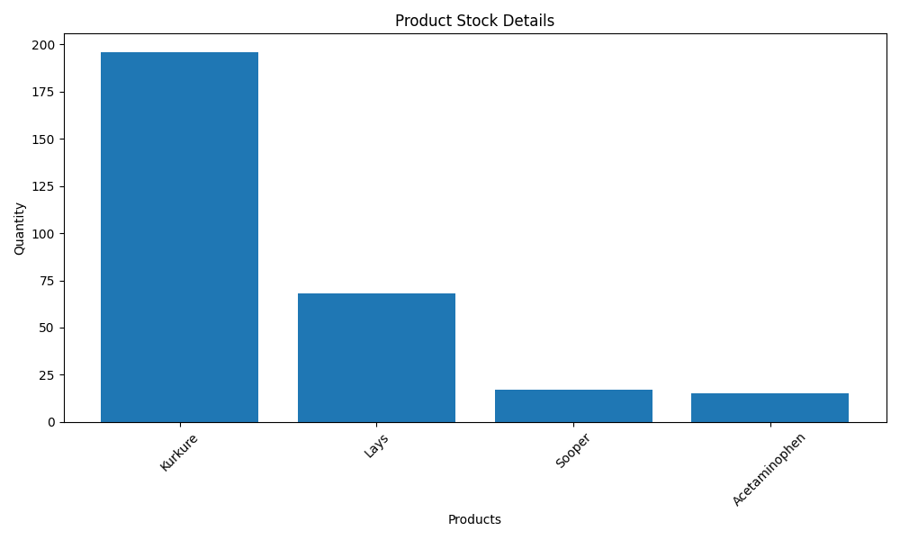
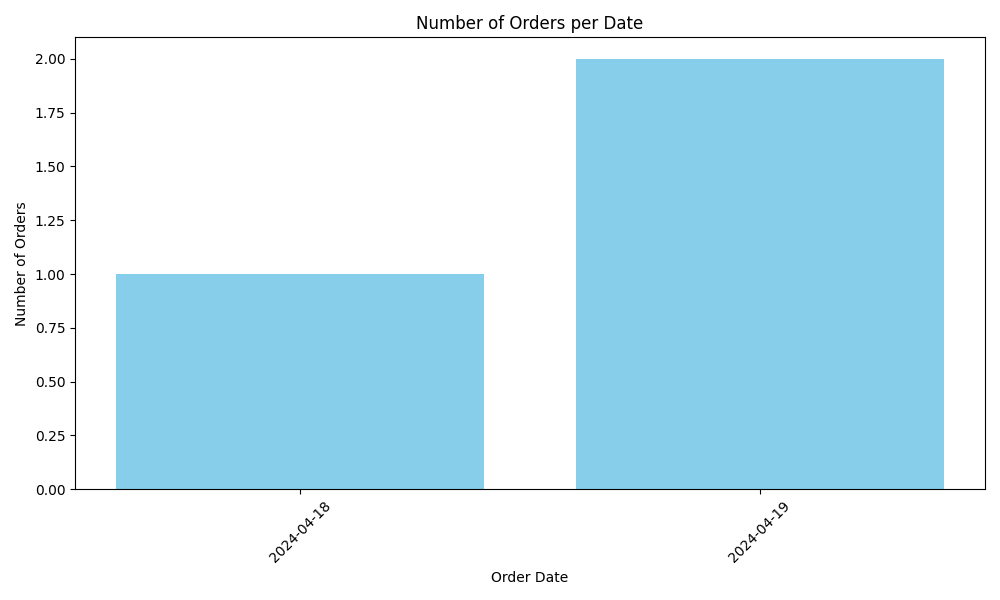

# Sales Order Processing System

A full-stack web application for managing a small business's stock, clients and sales orders, built with **Python, Flask and SQLite**.

Staff can register and log in securely, manage clients and products, place and track orders, keep inventory up to date automatically, generate PDF invoices and reports, and view sales and stock charts.

## Features

**Accounts and security**
- Registration and login with bcrypt-hashed passwords and session-based authentication
- Password strength rules (8+ characters, upper and lower case, a number and a special character)
- Google reCAPTCHA on login and registration
- Password recovery via a one-time reset code sent by email

**Clients**
- Create, view, search, edit and delete clients, with duplicate-email checks

**Stock and products**
- Add new products or restock existing ones
- Search by product ID or name, edit and delete stock
- Low-stock alerts for products below 20 units

**Orders**
- Create orders with stock-availability checks and a QR code for each order
- Confirm orders, which deducts stock and records the payment automatically
- Edit, cancel, delete and search orders, with stock levels adjusted on edits

**Invoices and reports**
- Generate PDF invoices per order, then download them or email them to the client
- PDF reports for clients (top 10 by order count), products, stock (last 24 hours), orders (last 7 days) and payments (current month)
- Charts of orders per day and stock per product, built with Matplotlib

**Deliveries**
- Delivery tracking with status per order
- Deadline-based delivery prioritisation using a priority queue (`heapq`)

## Screenshots

| Stock per product | Orders per day |
|---|---|
|  |  |

A sample generated invoice is available here: [docs/sample_invoice.pdf](docs/sample_invoice.pdf)

## Tech stack

| Layer | Technology |
|---|---|
| Backend | Python, Flask, Flask-SQLAlchemy |
| Database | SQLite |
| Frontend | HTML (Jinja2 templates), CSS, JavaScript |
| Security | bcrypt, Google reCAPTCHA, Flask sessions |
| Documents and charts | pdfkit with wkhtmltopdf, qrcode, Matplotlib |
| Email | smtplib (Gmail SMTP) |

## Project structure

```
├── app.py              # Flask app: models, routes and business logic
├── templates/          # Jinja2 HTML templates (pages, invoices and reports)
├── static/             # CSS and JavaScript
├── docs/               # Screenshots and a sample invoice
└── requirements.txt
```

## Getting started

### Prerequisites
- Python 3.10+
- [wkhtmltopdf](https://wkhtmltopdf.org/downloads.html), needed for PDF invoices and reports. Set its install path on line 60 of `app.py`.

### Installation

```bash
git clone https://github.com/Wasaey-Q/Sales-Ordering-Processing-System.git
cd Sales-Ordering-Processing-System
pip install -r requirements.txt
```

### Configuration

Credentials are read from environment variables, not stored in the code:

| Variable | Purpose |
|---|---|
| `FLASK_SECRET_KEY` | Signs login sessions |
| `GMAIL_ADDRESS` | Gmail account used to send reset codes and invoices |
| `GMAIL_APP_PASSWORD` | [App password](https://support.google.com/accounts/answer/185833) for that Gmail account |
| `RECAPTCHA_SECRET_KEY` | Google reCAPTCHA v2 secret key |

On macOS or Linux:
```bash
export FLASK_SECRET_KEY="any-long-random-string"
export GMAIL_ADDRESS="you@gmail.com"
export GMAIL_APP_PASSWORD="your-app-password"
export RECAPTCHA_SECRET_KEY="your-recaptcha-secret"
```

On Windows (PowerShell):
```powershell
$env:FLASK_SECRET_KEY="any-long-random-string"
$env:GMAIL_ADDRESS="you@gmail.com"
$env:GMAIL_APP_PASSWORD="your-app-password"
$env:RECAPTCHA_SECRET_KEY="your-recaptcha-secret"
```

If you create your own reCAPTCHA keys, also replace the public site key in `templates/index.html` and `templates/register.html`, and add `localhost` to the allowed domains.

### Run

```bash
python app.py
```

Then open http://127.0.0.1:5000. The SQLite database is created automatically on first run. Register an account to get started.

## Possible improvements
- Require login on every route with a shared decorator
- Restore stock automatically when an order is cancelled or deleted
- Add expiry times to password reset codes
- Move the wkhtmltopdf path into configuration
